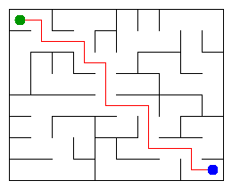

# Assignment 3. Maze Escape

Student ID: 253502
Name:Dias
Group: SE-2511
Maze size (rows x columns): 8 x 10

This file is the report. Fill it in as you go. How to start: `START_HERE.md`. The task: `docs/Assignment3.pdf`.

## Program output

The 13 lines your program prints on your data (`java -cp out Main`):

    Broken: 79
    Kept: 63
    Last broken wall: 124
    MST cost: 22642
    Heaviest broken wall: 792
    Path length: 16
    DFS visited: 48
    Dead ends: 25
    Zones: 10
    Largest zone: 15
    Is DAG: 0
    Flow stages: 8
    Fastest route cost: 16

My maze:

## Questions

Answer in your own words, two or three sentences each.

Mission 0. What do find and union do, and what makes them fast in your code?
The find method finds the root of a set. The union method connects two different sets.
I used path compression and union by size to make these operations faster.

Mission 1. Why is Broken always R*C - 1, and Kept always (R-1)*(C-1)?
There are RC cells, and we need RC - 1 connections to connect all cells without cycles.
The other walls stay because breaking them would create cycles. The number of remaining walls is (R-1)*(C-1).

Mission 2. My MST cost from Kruskal and from Prim, and why they are equal:
Kruskal MST cost: 22642. Prim MST cost: 22642. Both algorithms find a minimum spanning tree, so their total costs are equal.

Mission 3. Why is there exactly one path between two cells? How did you avoid a stack overflow on a huge maze?
The maze is a tree because all cells are connected and there are no cycles. A tree has exactly one path between any two cells.
I used an iterative DFS with an array stack instead of recursion.

Mission 4. Why does the second pass of Kosaraju go on the reversed graph? Why do the slides have no cycle exactly when Zones equals the number of cells?
The reversed graph helps find all cells in the same strongly connected component.
If every cell is in its own zone, there are no directed cycles because the slides have no self-loops.

Mission 5. Why is it enough to go through the zones in the order of their numbers? What does this pass cost?
The zone numbers are in topological order. Every edge between zones goes from a smaller number to a larger number.
We can process each zone and edge once, so the time complexity is O(V + E) for the zone graph.

## AI use
I used ChatGPT to understand DSU, Kruskal, Prim, DFS, Kosaraju, and shortest paths in DAGs.

## Timing (Mission 7)

Milliseconds, 5 runs each, from `java -cp out Bench`.

| maze | Kruskal | Prim |
|---|---------|------|
| 100 x 100 | 10      | 12   |
| 300 x 300 | 64      | 114  |
| 1000 x 1000 | 818     | 3261 |

What do the numbers say about how the time grows? Two or three sentences.
When the maze size increases, both algorithms take more time. In my tests, Kruskal was faster than Prim for all three maze sizes.
Prim became much slower on the largest maze.

## Complexity

n is the number of cells, m the number of walls (or slides). Fill in every algorithm you wrote.

| algorithm               | time | space | assumptions |
|-------------------------|---|---|---|
| DSU find and union      |O(α(n)) amortized |O(n) |Path compression and union by size |
| Kruskal                 |O(m log m) |O(n + m) |Sorting edges and using DSU |
| Prim                    |O(m log m) |O(n + m) |Priority queue and adjacency lists |
| DFS                     |O(n + m) |O(n + m) |Iterative DFS |
| Kosaraju                |O(n + m) |O(n + m) |Two iterative DFS passes |
| Route in the zone graph |O(V + E) |O(V + E) |Zones are in topological order |

## Before you submit

- data/walls.txt, data/slides.txt and output/maze.png are in the repository.
- `java tools/Check.java` shows all examples right.
- This README is filled in, the program output and the section AI use included.
- The work is pushed to main (at least one commit per mission) and the repository is public.
- The link is attached in Moodle.
